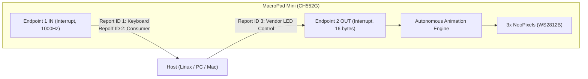

# Interface Control Document (ICD)
## MacroPad Mini (3 Keys + 1 Knob) - USB HID & RGB LED Protocol

**Device Identification:**
- **USB Vendor ID (VID):** `0x1189`
- **USB Product ID (PID):** `0x8890`
- **Manufacturer String:** `wagiminator`
- **Product String:** `MacroPad`
- **USB Specification:** USB 1.1 / 2.0 Full-Speed (12 Mbps)
- **Target OS:** Linux (universal `hidraw`), Windows, and macOS (standard USB HID support).

---

## 1. USB Communication Architecture

The MacroPad enumerates as a standard USB HID composite device (**Interface 0**) without requiring custom drivers or kernel modules. It uses two main endpoints:



### Endpoints and Polling
| Endpoint | Direction | Type | Packet Size (MaxPacket) | Interval (`bInterval`) | Purpose |
| :--- | :--- | :--- | :--- | :--- | :--- |
| **EP0** | Bidirectional | Control | 64 bytes | - | Standard enumeration and descriptors. |
| **EP1** | IN (Device -> Host) | Interrupt | 16 bytes | 1 ms (1000 Hz) | Key press reports and consumer / multimedia controls. |
| **EP2** | OUT (Host -> Device) | Interrupt | 16 bytes | 1 ms | Host RGB lighting commands. |

---

## 2. Input Reports (MacroPad -> Host)

### 2.1. Report ID 0x01: Standard Keyboard Input
Emitted on `EP1 IN` whenever a key configured in Keyboard or Macro mode is pressed or released.

**Size:** 9 bytes (1 byte Report ID + 8 bytes HID Keyboard Report)
```text
Offset  Size    Description
------  ------  -------------------------------------------------------------
0x00    1 byte  Report ID = 0x01
0x01    1 byte  Modifiers bitmask (Ctrl, Shift, Alt, GUI)
0x02    1 byte  Reserved (0x00)
0x03    1 byte  Keycode 1 (Currently pressed key)
0x04    1 byte  Keycode 2
0x05    1 byte  Keycode 3
0x06    1 byte  Keycode 4
0x07    1 byte  Keycode 5
0x08    1 byte  Keycode 6
```

#### Modifiers Bitmask (Byte 1):
- Bit 0: Left Ctrl (`0x01`)
- Bit 1: Left Shift (`0x02`)
- Bit 2: Left Alt (`0x04`)
- Bit 3: Left GUI / Super (`0x08`)
- Bit 4: Right Ctrl (`0x10`)
- Bit 5: Right Shift (`0x20`)
- Bit 6: Right Alt (`0x40`)
- Bit 7: Right GUI (`0x80`)

---

### 2.2. Report ID 0x02: Consumer / Multimedia Control
Emitted on `EP1 IN` for multimedia keys (Play, Pause, Mute, Volume Up, Volume Down, etc.).

**Size:** 9 bytes (1 byte Report ID + 4 slots of 16-bit Consumer Usages)
```text
Offset  Size    Description
------  ------  -------------------------------------------------------------
0x00    1 byte  Report ID = 0x02
0x01    2 bytes Consumer Usage Code 1 (Little-Endian: LSB first, MSB second)
0x03    2 bytes Consumer Usage Code 2
0x05    2 bytes Consumer Usage Code 3
0x07    2 bytes Consumer Usage Code 4
```

---

## 3. RGB LED Control Protocol (Host -> MacroPad)

The host controls LED states and animations by sending an output report (**Report ID 0x03**) via `/dev/hidrawX` (Linux) or Endpoint 2 OUT.

### 3.1. Command Packet Structure (16 bytes)

```text
Byte 0:  REPORT_ID   -> 0x03
Byte 1:  LED_INDEX   -> 0 (LED 1), 1 (LED 2), 2 (LED 3), or 0xFF (ALL LEDs)
Byte 2:  MODE        -> 0: OFF, 1: SOLID, 2: BREATHE, 3: BLINK, 4: REACTIVE
Byte 3:  RED         -> Red component (0 - 255)
Byte 4:  GREEN       -> Green component (0 - 255)
Byte 5:  BLUE        -> Blue component (0 - 255)
Byte 6:  PERIOD_MS_H -> Period high byte (ms >> 8)
Byte 7:  PERIOD_MS_L -> Period low byte  (ms & 0xFF)
Byte 8..15: 0x00     -> Reserved padding (0x00)
```

### 3.2. Lighting Modes Table (`MODE`)
| Value | Mode | Description | Period Parameter Behavior |
| :---: | :--- | :--- | :--- |
| `0x00` | **OFF** | Completely turns off the selected LED(s). | Ignored. |
| `0x01` | **SOLID** | Static continuous illumination with color `(R, G, B)`. | Ignored. |
| `0x02` | **BREATHE** | Smooth breathing animation using quadratic gamma curve `(factor * factor) >> 8`. | Full cycle duration in milliseconds (e.g. 4000 = 4.0s). Starts at brightness 0. |
| `0x03` | **BLINK** | Square blink at 50% duty cycle (half cycle OFF, half cycle ON). | Full cycle duration in milliseconds (e.g. 1000 = 1.0s). Starts in OFF phase. |
| `0x04` | **REACTIVE** | Reactive to physical key presses (illuminates with target `(R, G, B)` on press, then fades smoothly down). Setting `(0, 0, 0)` turns the LED off. | Fade decay duration in milliseconds. |

### 3.3. Guaranteed Execution Sequence (Anti-Flash & Phase Sync)
Upon receiving a packet for one or all LEDs, the microcontroller executes the following atomic sequence:
1. **Immediate Blackout:** Sets physical output of target LEDs to `(0, 0, 0)` and latches WS2812B immediately.
2. **Parameter Update:** Applies the new mode, target `(R, G, B)` color, and period while LEDs are dark.
3. **Phase Reset:** Resets the phase timer to zero (`timer = 0`). If `LED_INDEX == 0xFF`, all 3 LEDs begin their cycle simultaneously in **perfect phase**.
4. **Resumption:** The animation engine resumes rendering smoothly without flickers, jumps, or visual artifacts.

---

## 4. Linux Host Setup

### 4.1. udev Rule (Non-root user access)
Install the provided udev rule from `tools/udev/99-macropad.rules`:
```bash
sudo cp tools/udev/99-macropad.rules /etc/udev/rules.d/
sudo udevadm control --reload-rules && sudo udevadm trigger
```
The rule grants read/write permissions for both operational HID control and bootloader flashing:
```udev
# 1. Operational Mode: RGB LED Control via hidraw (VID: 1189, PID: 8890)
KERNEL=="hidraw*", ATTRS{idVendor}=="1189", ATTRS{idProduct}=="8890", MODE="0666", TAG+="uaccess"

# 2. Bootloader / ISP Mode: Firmware & EEPROM Flashing (VID: 4348, PID: 55e0)
SUBSYSTEM=="usb", ATTRS{idVendor}=="4348", ATTRS{idProduct}=="55e0", MODE="0666", TAG+="uaccess"
```

### 4.2. Host Device Discovery
The host can locate the active `/dev/hidrawX` node by searching for the device ID in `/sys/class/hidraw/hidraw*/device/uevent`:
```text
HID_ID=0003:00001189:00008890
```

---

## 5. Developer Implementation Examples

### 5.1. Python (Zero External Dependencies)
```python
import os, glob, re

def set_macropad_led(led_idx, mode, r, g, b, period_ms=2000):
    """
    led_idx: 0 (LED1), 1 (LED2), 2 (LED3), or 0xFF (ALL)
    mode: 0=OFF, 1=SOLID, 2=BREATHE, 3=BLINK, 4=REACTIVE
    r, g, b: 0-255
    period_ms: duration in milliseconds
    """
    dev_path = None
    for syspath in glob.glob("/sys/class/hidraw/hidraw*"):
        uevent = os.path.join(syspath, "device", "uevent")
        if os.path.exists(uevent):
            with open(uevent, "r") as f:
                if "00001189:00008890" in f.read():
                    dev_path = os.path.join("/dev", os.path.basename(syspath))
                    break

    if not dev_path:
        raise FileNotFoundError("MacroPad not found.")

    packet = bytearray(16)
    packet[0] = 0x03                    # Report ID
    packet[1] = led_idx & 0xFF          # LED Index (0, 1, 2, 0xFF)
    packet[2] = mode & 0xFF             # Mode
    packet[3] = r & 0xFF                # Red
    packet[4] = g & 0xFF                # Green
    packet[5] = b & 0xFF                # Blue
    packet[6] = (period_ms >> 8) & 0xFF # Period MSB
    packet[7] = period_ms & 0xFF        # Period LSB

    with open(dev_path, "wb") as f:
        f.write(packet)

# Example: All 3 LEDs breathing purple in perfect phase with a 3-second period
set_macropad_led(0xFF, 2, 180, 0, 255, 3000)
```

### 5.2. C (Linux `hidraw`)
```c
#include <fcntl.h>
#include <unistd.h>
#include <stdint.h>
#include <stdio.h>

int set_led(const char* hidraw_path, uint8_t led_idx, uint8_t mode, 
            uint8_t r, uint8_t g, uint8_t b, uint16_t period_ms) {
    uint8_t packet[16] = {0};
    packet[0] = 0x03;
    packet[1] = led_idx;
    packet[2] = mode;
    packet[3] = r;
    packet[4] = g;
    packet[5] = b;
    packet[6] = (period_ms >> 8) & 0xFF;
    packet[7] = period_ms & 0xFF;

    int fd = open(hidraw_path, O_RDWR);
    if (fd < 0) return -1;
    ssize_t written = write(fd, packet, sizeof(packet));
    close(fd);
    return (written == sizeof(packet)) ? 0 : -1;
}
```
