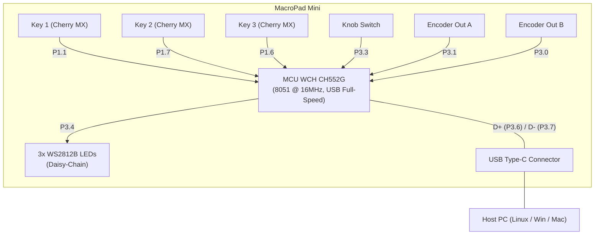

# MacroPad Mini (3 Keys + 1 Knob) with CH552G

> [!NOTE]
> This fork was vibe-coded using **Google Gemini Flash 3.8** in **Antigravity CLI**. I used it to improve the original firmware, fix the rotary encoder double-stepping with a full-step FSM, implement clean switch debouncing, and add an autonomous USB HID lighting engine to control the RGB LEDs directly from the host.

Open-source firmware and technical documentation for the cheap 3-mechanical-key and 1-rotary-encoder MacroPad based on the **WCH CH552G** microcontroller.

Features software debouncing, full-step finite state machine (FSM) rotary encoder decoding, key mapping via EEPROM (Data Flash), and **autonomous host-controlled addressable RGB lighting (WS2812B)** via USB HID.

---

## 1. Hardware Overview & Architecture

The MacroPad operates as a composite USB HID input device, acting simultaneously as a standard keyboard (HID Keyboard), multimedia controller (Consumer Control), and lighting controller (Vendor Output Report).

### Hardware Architecture



1. **Microcontroller (MCU): WCH CH552G**
   - Enhanced 8051 core running at 16 MHz using the internal oscillator (no external crystal required).
   - 16 KB Flash memory (14 KB usable for code, ~2 KB factory ROM bootloader).
   - 128 bytes Data Flash (used as non-volatile EEPROM for key configurations).
   - Integrated native USB 2.0 Full-Speed controller.
2. **Mechanical Keys:**
   - 3 hot-swappable mechanical switches (Key 1, Key 2, Key 3) connected to ground with internal pull-up resistors active.
   - 15 ms lockout software debouncing eliminates mechanical switch chatter without adding perceptible input latency.
3. **Rotary Encoder (Knob):**
   - Mechanical quadrature encoder with center detents and integrated tactile push switch.
   - Decoded using **Ben Buxton's Full-Step Finite State Machine (FSM)**:
     - Exactly 1 event emitted per physical detent (click).
     - Full immunity to contact bounce and intermediate chatter.
     - Zero reverse/glitch events when spun quickly.
4. **RGB Illumination:**
   - 3 addressable WS2812B LEDs (NeoPixels) placed under each switch.
   - Single-wire high-speed serial bus on pin `P3.4` (800 kHz).
   - Autonomous animation engine supporting 5 modes: `OFF`, `SOLID`, `BREATHE`, `BLINK`, and `REACTIVE`.

### Pinout Mapping (CH552G)
| Function | MCU Pin | GPIO Mode | Description |
| :--- | :---: | :--- | :--- |
| **PIN_KEY1** | `P1.1` | Input with pull-up | Key 1 (left switch) |
| **PIN_KEY2** | `P1.7` | Input with pull-up | Key 2 (center switch) |
| **PIN_KEY3** | `P1.6` | Input with pull-up | Key 3 (right switch) |
| **PIN_ENC_SW** | `P3.3` | Input with pull-up | Knob integrated push switch |
| **PIN_ENC_A** | `P3.1` | Input with pull-up | Rotary encoder quadrature channel A |
| **PIN_ENC_B** | `P3.0` | Input with pull-up | Rotary encoder quadrature channel B |
| **PIN_NEO** | `P3.4` | Push-Pull Output | WS2812B data line (via 330Ω resistor) |
| **USB D+ / BOOT** | `P3.6` | USB D+ / Input | USB D+ data line (forced pull-up triggers Bootloader) |
| **USB D-** | `P3.7` | USB D- | USB D- data line |

---

## 2. Entering Bootloader Mode

The CH552 includes a factory ROM bootloader that enables flashing firmware directly over USB without external hardware programmers (`VID:PID = 4348:55e0`).

> [!IMPORTANT]
> **First-Time Flashing from Factory Stock Firmware:**
> Off-the-shelf commercial macropads ship from the factory with closed-source proprietary firmware that does **NOT** support software bootloader triggers.
> - **Initial Flash:** You **MUST** use **Method B (1 kΩ hardware pull-up)** at least once to flash this open-source firmware onto a new device.
> - **Subsequent Flashes:** Once this firmware is installed on the device, you can close the case permanently and use **Method A (holding Key 1)** for all future updates.

```
       ┌────────────────────────────────────────────────────────┐
       │                BOOTLOADER MODE (4348:55e0)             │
       └───────────┬────────────────────────────────┬───────────┘
                   │                                │
                   ▼                                ▼
       [FIRST-TIME FLASH / RECOVERY]       [SUBSEQUENT FLASHES]
           Method B (Hardware)              Method A (Software)
        1kΩ resistor between D+ and 5V      Hold KEY 1 while plugging USB
        (Stock factory or bricked MCU)      (Running this open-source FW)
```

### Method B: Hardware Pull-up (MANDATORY for First Flash / Recovery)
This method forces the microcontroller's unalterable internal factory ROM into bootloader mode at power-on:
1. **Unscrew the bottom plate** of the macropad to access the underside of the PCB.
2. The WCH bootloader checks at power-on whether line `D+` (`P3.6`) is pulled high.
3. With the board disconnected from USB, temporarily hold a **1 kΩ resistor between pin P3.6 (D+) and 5V (VBUS / VCC)** (or across the boot pads on boards equipped with them).
4. Plug in the USB cable to your computer.
5. Within the 3-second countdown provided by the flasher, remove the resistor.
6. Verify detection with `lsusb`:
   ```text
   ID 4348:55e0 WinChipHead
   ```

### Method A: Software Trigger (For Subsequent Flashes)
Once this custom firmware has been flashed to the device, hardware access is no longer required:
1. Unplug the USB cable from the MacroPad.
2. Press and hold **KEY 1** (the leftmost mechanical key).
3. Plug the USB cable back into your computer and release the key.
4. The firmware detects the held key at startup, briefly flashes the LEDs white, and transfers execution to the ROM bootloader (`BOOT_now()`).
5. Running `lsusb` will confirm bootloader mode (`4348:55e0`).

---

## 3. Building, Setup, and Flashing

### 3.1. Toolchain & Python Environment
- **Compiler:** `sdcc` (Small Device C Compiler)
- **Python Tools:** `pyusb`, `ch55xtool`, `evdev`

#### 1. Install SDCC Compiler
On Arch Linux:
```bash
sudo pacman -S sdcc
```
On Debian / Ubuntu:
```bash
sudo apt install sdcc
```

#### 2. Create Python Virtual Environment & Install Dependencies
Create an isolated environment and install the required tools:
```bash
python3 -m venv .venv
source .venv/bin/activate
pip install -r tools/requirements.txt
```

### 3.2. Linux udev Rules (Non-Root USB Access)
Install the provided udev rule to grant non-root permissions for **both firmware flashing and runtime RGB LED control**:
```bash
sudo cp tools/udev/99-macropad.rules /etc/udev/rules.d/
sudo udevadm control --reload-rules && sudo udevadm trigger
```

### 3.3. Compiling Firmware
```bash
make bin
```
This compiles the C source code and generates the binary file `3keys_1knob.bin`.

### 3.4. Flashing Firmware & Default Keymap
Put the MacroPad in Bootloader mode (**Method B** for a new factory board, or **Method A** if already running this firmware) and run:
```bash
python tools/flash.py
```
*(No `sudo` required once the udev rule is installed).*

---

## 4. Key Mapping & Configuration (EEPROM / Data Flash)

The CH552 features 128 bytes of non-volatile Data Flash. Key definitions are stored in a table containing **6 slots of 12 bytes each** (72 bytes total):

```text
Offset       Target Control
------       ----------------------------------------------
0x00 - 0x0B: Key 1 (left switch)
0x0C - 0x17: Key 2 (center switch)
0x18 - 0x23: Key 3 (right switch)
0x24 - 0x2F: Rotary knob push button
0x30 - 0x3B: Knob clockwise rotation (CW)
0x3C - 0x47: Knob counter-clockwise rotation (CCW)
```

### 4.1. Slot Structure (12 Bytes per Key)

The first byte (`Byte 0`) defines the key type:

#### Type 0x00: Standard Keyboard
Supports up to two alternating states (toggle) with modifiers:
```text
Byte 0: 0x00 (Keyboard Type)
Byte 1: Modifier 1 (Ctrl, Shift, Alt, etc.)
Byte 2: HID Keycode 1 (e.g. 0x04 = 'a')
Byte 3: Modifier 2 (for alternating state)
Byte 4: HID Keycode 2
Bytes 5..11: 0x00 (Reserved padding)
```

#### Type 0x01: Consumer / Multimedia Key
Sends media commands such as volume up/down, mute, or play/pause:
```text
Byte 0: 0x01 (Consumer Type)
Byte 1: Consumer Code 1 LSB (e.g. 0xE9 = Vol +)
Byte 2: Consumer Code 1 MSB (e.g. 0x00)
Byte 3: Consumer Code 2 LSB
Byte 4: Consumer Code 2 MSB
Bytes 5..11: 0x00 (Reserved padding)
```

#### Type 0x02: Macro Sequence
Emits a sequential stream of keycodes on press:
```text
Byte 0: 0x02 (Macro Type)
Byte 1: Keystroke count in sequence (up to 10)
Bytes 2..11: Consecutive HID keycodes sent with inter-keystroke delays.
```

### 4.2. Reference Tables

#### Keyboard Modifiers
| Hex Value | Modifier |
| :---: | :--- |
| `0x00` | None |
| `0x01` | Ctrl |
| `0x02` | Shift |
| `0x03` | Ctrl + Shift |
| `0x04` | Alt |
| `0x05` | Ctrl + Alt |
| `0x06` | Shift + Alt |
| `0x07` | Ctrl + Shift + Alt |

#### Common Consumer / Multimedia Codes
| Hex Code | Function |
| :---: | :--- |
| `0x00E2` | Mute |
| `0x00E9` | Volume Up |
| `0x00EA` | Volume Down |
| `0x00B0` | Play |
| `0x00B1` | Pause |
| `0x00B5` | Next Track |
| `0x00B6` | Previous Track |
| `0x00B7` | Stop |

### 4.3. Keymap Configuration via JSON (`keymap.json`)
Keys and knob actions are comfortably configured in human-readable JSON using [`keymap.json`](keymap.json) in the project root:

```json
{
  "key1": {
    "type": "keyboard",
    "mod": ["ctrl"],
    "key": "c"
  },
  "key2": {
    "type": "keyboard",
    "mod": ["ctrl"],
    "key": "v"
  },
  "key3": {
    "type": "keyboard",
    "mod": ["ctrl"],
    "key": "z"
  },
  "knob_switch": {
    "type": "consumer",
    "action": "mute"
  },
  "knob_cw": {
    "type": "consumer",
    "action": "volume_up"
  },
  "knob_ccw": {
    "type": "consumer",
    "action": "volume_down"
  }
}
```

#### Slot Names & Aliases
Each of the 6 physical inputs can be referenced by its canonical name or common aliases:
| Input Slot | Canonical Key | Recognized Aliases |
| :--- | :--- | :--- |
| Left Mechanical Switch | `"key1"` | `"k1"`, `"1"`, `"left"` |
| Center Mechanical Switch | `"key2"` | `"k2"`, `"2"`, `"middle"`, `"center"` |
| Right Mechanical Switch | `"key3"` | `"k3"`, `"3"`, `"right"` |
| Rotary Knob Tactile Switch | `"knob_switch"` | `"knob_sw"`, `"knob_click"`, `"knob_button"`, `"enc_sw"` |
| Rotary Knob Clockwise | `"knob_cw"` | `"knob_right"`, `"enc_cw"`, `"cw"` |
| Rotary Knob Counter-Clockwise | `"knob_ccw"` | `"knob_left"`, `"enc_ccw"`, `"ccw"` |

---

#### Key Definition Types & Reference

##### 1. Standard Keyboard (`"type": "keyboard"`)
* **`mod` (Modifiers):** List of modifier strings combined via bitwise OR:
  - Left modifiers: `"ctrl"` (`"lctrl"`, `"control"`), `"shift"` (`"lshift"`), `"alt"` (`"lalt"`), `"gui"` (`"win"`, `"cmd"`, `"super"`, `"lgui"`).
  - Right modifiers: `"rctrl"`, `"rshift"`, `"ralt"` (`"altgr"`), `"rgui"` (`"rwin"`, `"rcmd"`).
  - You may also provide a direct bitmask in hex (e.g. `0x05` for Ctrl+Alt).
* **`key` (Keycode):** Standard USB HID keyboard key:
  - Letters: `"a"` through `"z"`
  - Numbers: `"0"` through `"9"`
  - Function keys: `"f1"` through `"f12"` (up to `"f24"`)
  - Navigation & Control: `"enter"` (`"return"`), `"esc"` (`"escape"`), `"backspace"`, `"tab"`, `"space"`, `"delete"` (`"del"`), `"insert"`, `"home"`, `"end"`, `"pageup"` (`"pgup"`), `"pagedown"` (`"pgdn"`), `"up"`, `"down"`, `"left"`, `"right"`, `"capslock"`, `"printscreen"` (`"prtsc"`), `"scrolllock"`, `"pause"`.
  - Symbols: `"-"`, `"="`, `"["`, `"]"`, `"\\"`, `";"`, `"'"` , ``"`"``, `","`, `"."`, `"/"`.
  - Raw Hex: Direct HID keycode string or integer (e.g. `"0x06"` for `'c'`).
* **Alternating / Toggle Key:** To send alternating keys on successive presses:
  ```json
  "key1": {
    "type": "keyboard",
    "toggle": [
      { "mod": ["ctrl"], "key": "c" },
      { "mod": ["ctrl"], "key": "v" }
    ]
  }
  ```

##### 2. Consumer / Multimedia (`"type": "consumer"`)
* **`action` (or `key`):** 16-bit USB HID Consumer usage name or raw code:
  - Audio: `"mute"` (`0x00E2`), `"volume_up"` (`0x00E9`), `"volume_down"` (`0x00EA`).
  - Playback: `"play_pause"` (`0x00CD`), `"stop"` (`0x00B7`), `"next_track"` (`0x00B5`), `"prev_track"` (`0x00B6`).
  - Display & System: `"brightness_up"` (`0x006F`), `"brightness_down"` (`0x0070`), `"eject"` (`0x00B8`).
  - Applications: `"calculator"` (`"calc"`, `0x0192`), `"media_player"` (`"media"`, `0x0183`), `"browser"` (`"browser_home"`, `0x0223`), `"browser_back"` (`0x0224`), `"browser_forward"` (`0x0225`), `"browser_refresh"` (`0x0227`).
  - Raw Hex: Any 16-bit code formatted as hex or integer (e.g. `"0x00E2"` or `226`).

##### 3. Macro Sequence (`"type": "macro"`)
* **`keys`:** An array of up to 10 consecutive keycodes typed in sequence upon pressing the switch:
  ```json
  "key3": {
    "type": "macro",
    "keys": ["h", "e", "l", "l", "o", "enter"]
  }
  ```

#### Compile-Time Validation & Safety
The compiler (`tools/keymap.py`) validates all names, modifiers, and keycodes **on your host PC before touching the USB interface or erasing the microcontroller**:
* Typing an unknown modifier (e.g. `"mod": ["ctrol"]`) immediately raises:
  `ValueError: Unknown modifier: ctrol`
* Typing an unlisted keycode or typo (e.g. `"key": "unknown_key"`) raises:
  `ValueError: Unknown keycode: unknown_key`
* The flashing process is aborted immediately without writing corrupt or invalid bytes to the device EEPROM.

### 4.4. Flashing and EEPROM Tools
The unified flasher [`tools/flash.py`](tools/flash.py) manages both firmware and EEPROM configuration:

- **Flash firmware AND keymap (default):**
  ```bash
  python tools/flash.py
  ```
- **Flash ONLY the EEPROM keymap (without touching firmware):**
  ```bash
  python tools/flash.py --eeprom-only
  # or using a custom keymap:
  python tools/flash.py --eeprom-only -k my_custom_keys.json
  ```
- **Flash ONLY the firmware binary (without touching EEPROM):**
  ```bash
  python tools/flash.py --skip-eeprom
  ```
- **Read / backup active EEPROM:**
  ```bash
  python tools/dump_eeprom.py eeprom_backup.bin
  ```

### 4.5. Live Input Diagnostics (`test_macropad.py`)
To monitor physical keystrokes, rotary encoder steps, and knob button clicks in real time:
```bash
sudo $(which python) tools/test_macropad.py
```
*(Requires `sudo` to inspect low-level Linux kernel `/dev/input/event*` devices. To exit the diagnostic monitor, press `Ctrl+C` 3 times rapidly to avoid accidental termination when testing Key 1).*

---

## 5. Host-Controlled RGB Lighting

The firmware provides an autonomous USB HID lighting subsystem. **The host issues a single command, and the microcontroller handles rendering and timing independently.**

*(Ensure the udev rule from [Section 3.2](#32-linux-udev-rules-non-root-usb-access) is installed to run without `sudo`).*

### 5.1. Using the CLI Tool (`macropad_led.py`)
```bash
# 1. Set LED 1 to solid green
python tools/macropad_led.py 1 --solid green

# 2. Set LED 2 to smooth blue breathing with a 4-second period
python tools/macropad_led.py 2 --breathe 4s "#0022FA"

# 3. Set LED 3 blinking red every 1 second
python tools/macropad_led.py 3 --blink 1s red

# 4. Synchronize all 3 LEDs breathing purple together (100% in phase)
python tools/macropad_led.py all --breathe 3s purple

# 5. Restore reactive mode on physical key presses
python tools/macropad_led.py all --reactive

# 6. Turn off all LEDs
python tools/macropad_led.py all --off
```

### 5.2. Developer Interface Specification (ICD)
For developers building custom host applications, daemons, or system integrations in Python, C, Go, or Rust, consult the complete specification:
👉 **[View Interface Control Document (ICD.md)](ICD.md)**

---

## 6. License and Credits

This firmware is a derivative work based on the following projects:
1. Original CH552 USB/HID firmware framework: [CH552-Macropad-mini](https://github.com/wagiminator/CH552-Macropad-mini) by **Stefan Wagner (wagiminator)**, licensed under [CC BY-SA 3.0 Unported](https://creativecommons.org/licenses/by-sa/3.0/).
2. Hardware reverse-engineering, rotary encoder support, and EEPROM layout: [3keys_1knob](https://github.com/biemster/3keys_1knob) by **biemster** ([Hackaday Project](https://hackaday.io/project/189914)).
3. Extended macro, toggle, and consumer key implementations: [Macropad-3-keys-1-knob](https://github.com/MrGeorgeK55/Macropad-3-keys-1-knob) by **MrGeorgeK55**.

Pursuant to Section 4(b) of CC BY-SA 3.0 (permitting adaptations to be licensed under a later version) and Section 3(b)(1) of CC BY-SA 4.0 (designating the GNU General Public License v3.0 as a BY-SA Compatible License), this adaptation and all modifications by Mariano Boragno are licensed under the **GNU General Public License v3.0 (GPLv3)**.

See the [LICENSE](LICENSE) file for the full license text. Note that `tools/chprog.py` retains its original **MIT License** by Stefan Wagner.

### Summary of Changes from Original
- **Full-Step FSM Rotary Encoder Debouncing:** Implemented Ben Buxton's state machine to eliminate double-stepping, missed detents, and erratic reverse triggers.
- **Switch Lockout Debounce:** Added 15 ms non-blocking lockout filter to eliminate mechanical contact chatter.
- **Autonomous RGB LED Subsystem:** Implemented on-chip animation engine for WS2812B LEDs with 5 modes (Solid, Breathe, Blink, Reactive, Off) running independently from the host.
- **USB HID Output Protocol (Report ID 3):** Added Endpoint 2 OUT with a vendor-defined collection (`0xFF00`) to control lighting in real-time from any OS without root/admin restrictions.
- **Anti-Flash & Phase Synchronization:** Added atomic blackout, parameter latching, and phase reset sequence to synchronize all LEDs smoothly.
- **Documentation & Tooling:** Complete Interface Control Document (ICD), automated flasher, Python CLI utility, and Linux udev rules.
